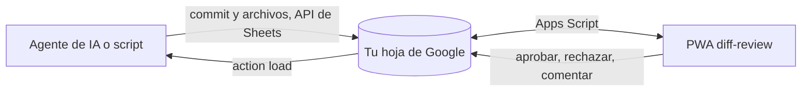

# 🔍 diff-review

**Mobile code review for AI agent commits: review git diffs and change graphs on your phone, without pull requests, on your own Google Sheet.**

> Revisa desde el celular los commits que tu agente de IA escribe en tu propia hoja de Google: lee el diff y aprueba, rechaza o comenta.

**[▶ Ver demo](https://juliangdeveloper.github.io/diff-review/?demo=1)** · datos de ejemplo, sin conectar nada




## Cómo se usa
- En **Commits** ves la lista con su estado y la filtras por rama o estado; **Ramas** agrupa los commits por rama.
- Abre un commit para leer el diff de cada archivo, con números de línea y ajuste de líneas largas. La app calcula el diff en el navegador a partir del contenido de cada archivo antes y después del commit.
- **Graph**, en ese detalle, dibuja un bloque por archivo cambiado y flechas de quien provee a quien usa, armadas solas con los imports y las llamadas entre los archivos del commit. Cada bloque dice qué funciones agrega, cambia o quita. Si la hoja trae `graph_rule`, `graph_label`, `graph_order` o `graph_to`, esos datos ponen el título y reemplazan las frases, el orden o las flechas automáticas. Tocar un bloque abre el diff de ese archivo. Si no encuentra funciones ni conexiones, muestra un bloque por archivo con su tipo de cambio y sus líneas sumadas y quitadas; solo un commit sin archivos en la hoja muestra «Este commit no tiene datos de grafo».
- **Estructura**, junto a **Graph**, es un diagrama de flujo del commit con el método de [diffgraph](https://github.com/miltonlaufer/diffgraph): cada clase y función cambiada es un recuadro con sus parámetros y sus pasos dentro (rombos para `if` y `switch`; píldoras para `return`, `throw` y bucles; rectángulos para llamadas y `try`), unidos por flechas de flujo marcadas T, F o next y por flechas `calls` entre funciones. Verde es añadido, rojo quitado y amarillo modificado. Muestra **Antes** y **Después** lado a lado en pantallas anchas y con un selector en el iPhone; **Solo cambios** oculta lo que no cambió. Se mueve arrastrando, se acerca pellizcando o con los botones, y ⤢ lo encuadra entero. Tocar un nodo abre el diff de ese archivo en su línea. Analiza JavaScript, TypeScript, Apps Script (`.gs`) y Python en el navegador; el analizador se descarga solo la primera vez que abres **Estructura** o **Graph**.
- **Estructura** usa lo que haya en la hoja para cada archivo: el contenido completo de `files`; si falta, las filas de `structure` si existen o, si no, los fragmentos del `patch` de `diffs`; y si no hay código que analizar (otro lenguaje, binario o contenido incompleto), el archivo aparece como un nodo con sus líneas sumadas y quitadas. Cuando a algún archivo le falta contenido, arriba aparece «Estructura parcial: faltan contenidos de algunos archivos». Las frases opcionales del agente nunca ocultan lo calculado.
- **Aprobar**, **Rechazar** o **Comentar**, con un comentario opcional. Cada revisión queda en la pestaña `reviews` y aprobar o rechazar cambia el `status` del commit en la hoja; no toca git ni tu repositorio. Tu agente lee las revisiones con `load`. Comentar no cambia el estado.
- En **Historial** revisas todas las revisiones, de la más reciente a la más antigua.
- En **Ajustes** puedes poner un nombre de revisor para firmar tus revisiones.

## Conectar tu hoja
La app lee y escribe en una hoja de Google a través de un Apps Script que publicas tú. La URL y la clave se guardan solo en tu navegador, nunca en el repositorio. Dentro de la app, **Cómo preparar la hoja** trae estos pasos y el script listo para copiar.

**Prompt IA**, junto a ese botón, copia un prompt para pegar en tu asistente de IA: te guía paso a paso en la conexión y le explica a un agente de programación cómo cargar cada commit y sus archivos en la hoja, sin escribir la URL ni la clave en el repositorio.

1. Crea una hoja vacía en [sheets.new](https://sheets.new).
2. En la hoja: **Extensiones → Apps Script**, borra el ejemplo y pega el contenido de [`apps-script/Code.gs`](apps-script/Code.gs).
3. En **Configuración del proyecto → Propiedades del script**, crea `SECRET` con una clave larga.
4. **Implementar → Nueva implementación → Aplicación web**, con **Ejecutar como: yo** y **Acceso: cualquier usuario**; acepta los permisos.
5. Copia la URL que termina en `/exec`, pégala en **Ajustes** junto con la clave y pulsa **Probar conexión**.

La hoja se renombra `diff-review` y recibe sus pestañas (`commits`, `files`, `diffs`, `reviews`, `meta`) y columnas en la primera conexión. El menú **diff-review → Inicializar** de la hoja hace lo mismo a mano. Una pestaña nueva también recibe las columnas opcionales del grafo: `graph_rule` en commits y `graph_label`, `graph_order`, `graph_to` en files y diffs. Una pestaña que ya tiene sus columnas no se modifica.

La pestaña `files` lleva el contenido de cada archivo cambiado: `commit_sha`, `file_path`, `change_type`, `old_path`, `side`, `chunk_index`, `chunk_total` y `content`. `side` es `old` para el contenido antes del commit, `new` para el de después y `binary` para un archivo binario, que lleva una sola fila sin contenido. Un archivo nuevo solo lleva `new` y uno borrado solo `old`. Un contenido de más de 45.000 caracteres va partido en filas seguidas, con `chunk_index` desde 0.

`meta` guarda `schema_version` 3. Con el `Code.gs` actual, una hoja con `schema_version` 1 o 2 recibe la pestaña `files` y sube a 3 en la siguiente petición, sin tocar los datos. Los commits viejos se siguen viendo: el diff sale del `patch` de `diffs` y **Estructura** de la pestaña `structure`, que se sigue leyendo si existe pero ya no se crea, o, si no tiene filas para ese archivo, de los fragmentos del `patch`. Con un `Code.gs` anterior la app sigue mostrando esos commits viejos, pero no recibe `files`: un commit que solo trae contenido aparece sin diffs y con el aviso de actualizar `Code.gs`.

Si cambias `Code.gs`: **Implementar → Gestionar implementaciones → Editar → Nueva versión** (la URL no cambia).

Para cargar commits con `files` en una hoja que ya tenías, pega el `Code.gs` actual y publica una nueva versión; no hace falta volver a inicializar.

### Cómo llegan los commits
La app y el Apps Script no suben commits: solo leen y guardan revisiones. Los commits y el contenido de sus archivos se escriben directo en la hoja, con la API de Google Sheets o a mano, en modo `RAW`, que guarda tal cual los SHAs y el texto. Por cada archivo el agente sube el contenido antes (`git show SHA^:ruta`) y después (`git show SHA:ruta`) del commit; no necesita instalar nada ni generar diffs. La parte 2 de **Prompt IA** le dice qué columnas llenar después de cada commit, cómo verificarlo con las acciones `ping` y `diffs`, y cómo leer tus revisiones con `load`.

Con ese contenido la app calcula en el navegador el diff unificado y las líneas sumadas y quitadas (algoritmo de Myers), **Estructura** y **Graph**.

### Seguridad
- El Apps Script se publica con acceso para **cualquier usuario**. Cada petición es un `POST` con la clave en el cuerpo JSON, que se compara con `SECRET` en las propiedades del script; sin ella, o sin `SECRET`, responde `forbidden`.
- Mantén en privado la URL `/exec` y la clave: la app las guarda en el `localStorage` del navegador.
- Con las dos, alguien podría leer todos los commits, archivos, diffs y revisiones de la hoja, y agregar revisiones o cambiar el estado de un commit. No puede subir commits ni tocar tu repositorio.
- Si se filtran, cambia `SECRET` en las propiedades del script y actualiza la clave en **Ajustes**.

## Stack
JavaScript vanilla (módulos ES), service worker para uso offline y Google Apps Script como backend. Sin bundler ni paso de build: el analizador de código es [Lezer](https://lezer.codemirror.net/) (licencia MIT, de Marijn Haverbeke), copiado ya minificado en [`js/vendor/lezer`](js/vendor/lezer) con su [aviso de licencia](js/vendor/lezer/LICENSE), y el diagrama de **Estructura** se ordena con [dagre](https://github.com/dagrejs/dagre) (licencia MIT, de Chris Pettitt), copiado sin cambios en [`js/vendor/dagre`](js/vendor/dagre) con su [aviso de licencia](js/vendor/dagre/LICENSE).

```
python3 -m http.server 8000   # abrir http://localhost:8000/?demo=1
```

Versión actual: `diff-review v0.5.0`.

Licencia: [MIT](LICENSE).

El análisis, la comparación y el diagrama de **Estructura** en [`js/diffgraph`](js/diffgraph) son una adaptación a JavaScript del código de [diffgraph](https://github.com/miltonlaufer/diffgraph) de Milton Läufer (licencia MIT), con su [aviso de licencia](js/diffgraph/LICENSE).

---

Más proyectos: https://juliangdeveloper.github.io/

Hecho con ❤️ y 🔍
