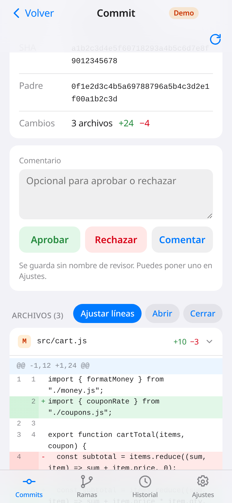

# 🔍 diff-review

> Revisa diffs de commits desde el celular, conectado a tu propia hoja de Google.

**[▶ Ver demo](https://juliangdeveloper.github.io/diff-review/?demo=1)** · datos de ejemplo, sin conectar nada



## Cómo se usa
- En **Commits** ves la lista con su estado y la filtras por rama o estado; **Ramas** agrupa los commits por rama.
- Abre un commit para leer el diff de cada archivo, con números de línea y ajuste de líneas largas.
- **Graph**, en ese detalle, dibuja un bloque por archivo si la hoja trae la regla y las conexiones. Tocar un bloque abre el diff de ese archivo. Si el commit no trae datos de grafo, el detalle sigue igual.
- **Aprobar**, **Rechazar** o **Comentar**, con un comentario opcional; el comentario no cambia el estado.
- En **Historial** revisas todas las revisiones, de la más reciente a la más antigua.
- En **Ajustes** puedes poner un nombre de revisor para firmar tus revisiones.

## Conectar tu hoja
La app lee y escribe en una hoja de Google a través de un Apps Script que publicas tú. La URL y la clave se guardan solo en tu navegador, nunca en el repositorio. Dentro de la app, **Cómo preparar la hoja** trae estos pasos y el script listo para copiar.

1. Crea una hoja vacía en [sheets.new](https://sheets.new).
2. En la hoja: **Extensiones → Apps Script**, borra el ejemplo y pega el contenido de [`apps-script/Code.gs`](apps-script/Code.gs).
3. En **Configuración del proyecto → Propiedades del script**, crea `SECRET` con una clave larga.
4. **Implementar → Nueva implementación → Aplicación web**, con **Ejecutar como: yo** y **Acceso: cualquier usuario**; acepta los permisos.
5. Copia la URL que termina en `/exec`, pégala en **Ajustes** junto con la clave y pulsa **Probar conexión**.

La hoja se renombra `diff-review` y recibe sus pestañas (`commits`, `diffs`, `reviews`, `meta`) y columnas en la primera conexión. El menú **diff-review → Inicializar** de la hoja hace lo mismo a mano. Una hoja nueva también recibe las columnas opcionales del grafo: `graph_rule` en commits y `graph_label`, `graph_order`, `graph_to` en diffs. Una hoja que ya tiene sus columnas no se modifica; si esas cabeceras no están, las filas viejas siguen igual y Graph no inventa el diagrama.

Si cambias `Code.gs`: **Implementar → Gestionar implementaciones → Editar → Nueva versión** (la URL no cambia).

Si cargas datos en la hoja por tu cuenta, escribe los valores en modo `RAW` para que Sheets no convierta SHAs ni líneas que empiezan con `+`, `-` o `=`.

## Stack
JavaScript vanilla (módulos ES), service worker para uso offline y Google Apps Script como backend. Sin bundler.

```
python3 -m http.server 8000   # abrir http://localhost:8000/?demo=1
```

Versión actual: `diff-review v0.2.7`.

---

Más proyectos: https://juliangdeveloper.github.io/

Hecho con ❤️ y 🔍
